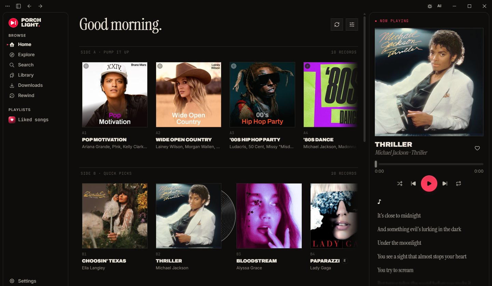
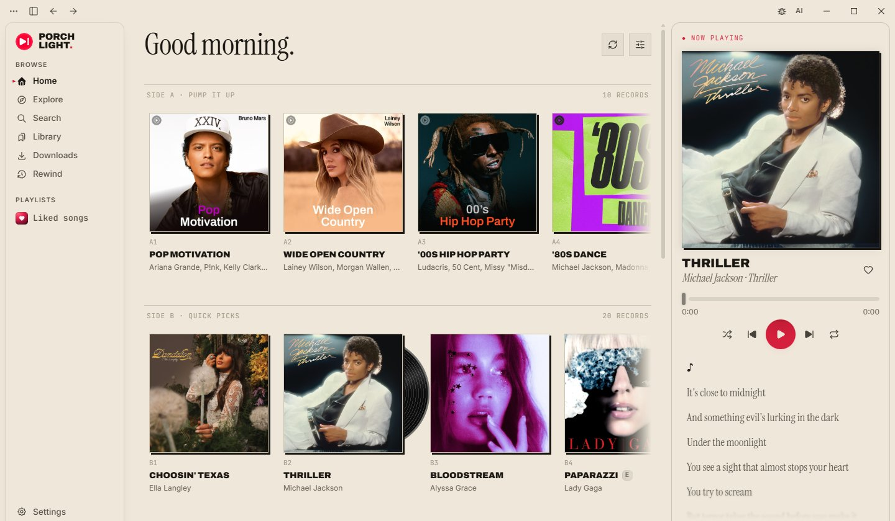
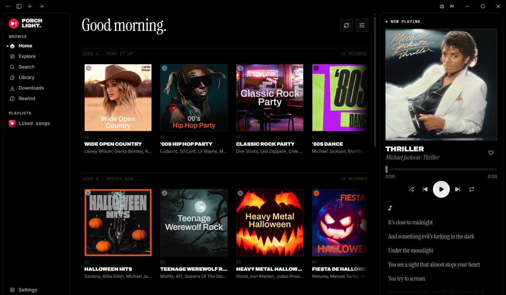
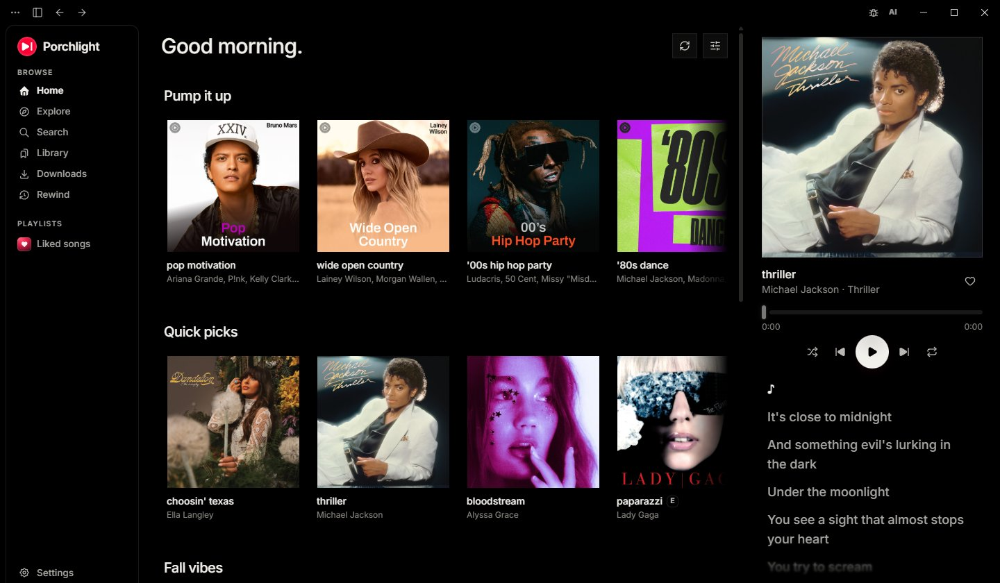
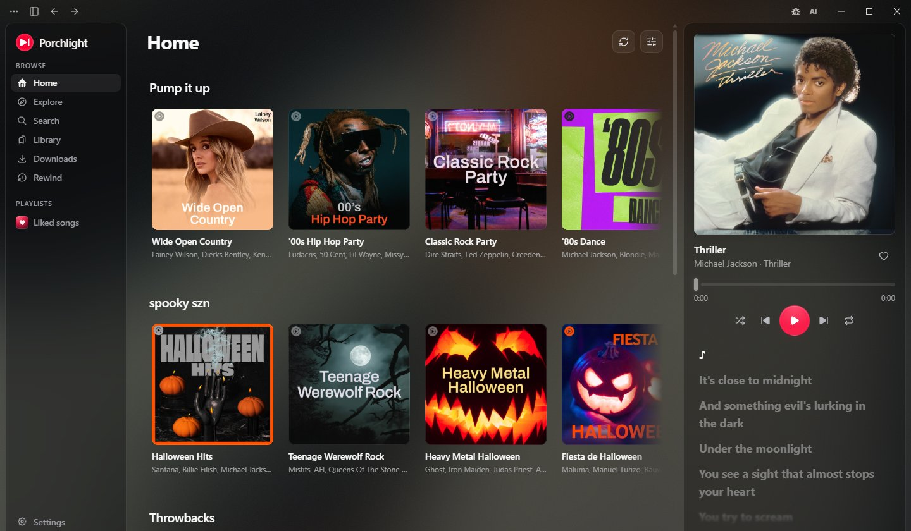
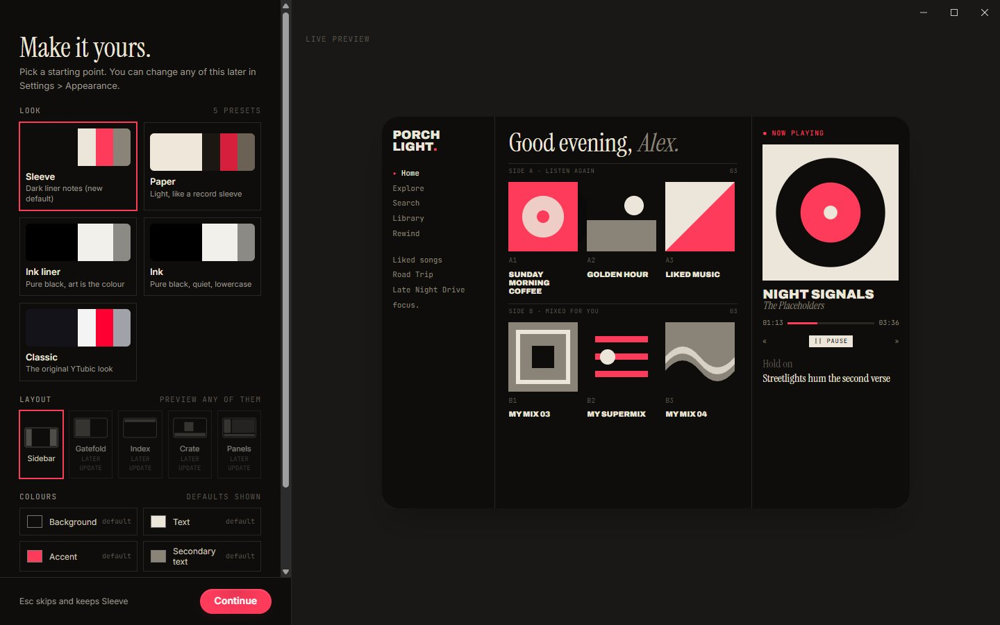
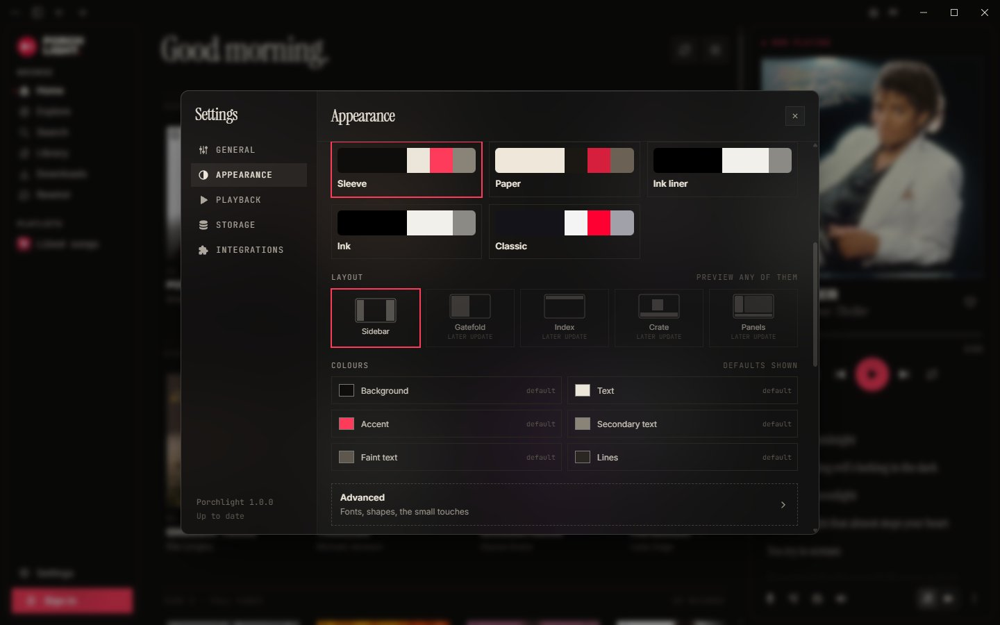
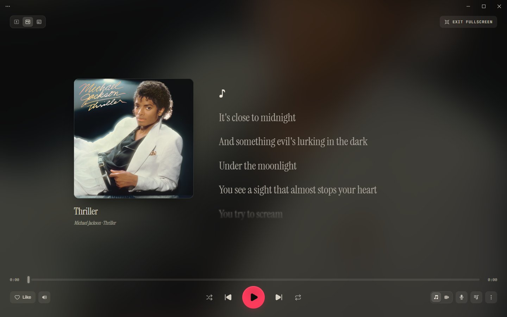

<p align="center">
  
</p>

<h1 align="center">Porchlight</h1>

<p align="center">
  A desktop YouTube Music app with its own look.<br />
  Fast, private, and yours to restyle.
</p>

<p align="center">
  <sub>A community edition by <a href="https://github.com/Homefronts"><b>Homefronts</b></a>,
  built on <a href="https://github.com/NUber-dev/YTubic"><b>YTubic</b></a> by George Shyshov (NUber).</sub>
</p>

<p align="center">
  <sub>Formerly YTubic Plus. Your library and settings move over on first launch.</sub>
</p>

<p align="center">
  <a href="LICENSE"></a>
</p>

<p align="center">
  <a href="https://github.com/Homefronts/Porchlight/releases/latest">
    
  </a>
  <a href="https://discord.gg/4gccUpZyYH">
    
  </a>
</p>

Built as a reaction to the sluggish webview-wrapper experience — YTubic talks to YouTube's InnerTube API directly, renders its own UI, and caches aggressively, so navigation and playback feel instant.

<p align="center">
  
</p>


## Looks

Porchlight ships with five looks. Switch any time in Settings > Appearance.

<table>
  <tr>
    <td width="50%" valign="top">
      <br />
      <b>Sleeve</b><br />
      Dark liner notes. Serif headlines, mono details, uppercase titles and one red accent. Records get A1 and B2 side numbers, and a vinyl peeks out of the last-played record.
    </td>
    <td width="50%" valign="top">
      <br />
      <b>Paper</b><br />
      The light liner notes. A cream sleeve, black ink, hard offset shadows on the covers and a red accent.
    </td>
  </tr>
  <tr>
    <td width="50%" valign="top">
      <br />
      <b>Ink liner</b><br />
      Liner notes type on pure black with no accent colour, so the cover art is the only colour on screen.
    </td>
    <td width="50%" valign="top">
      <br />
      <b>Ink</b><br />
      Pure black and quiet lowercase sans. No boxes and no numbering.
    </td>
  </tr>
  <tr>
    <td width="50%" valign="top">
      <br />
      <b>Classic</b><br />
      The original YTubic look, unchanged. Light, dark or system, with the ambient album art background.
    </td>
    <td></td>
  </tr>
</table>

## Make it yours

Pick a look on first launch, with a live preview of your own library. Then keep tweaking: change colours, fonts, corner shapes and the little record touches, and save the result as a custom look. Export a look as a theme file to share it, or import a friend's.

More looks and layouts are coming in content updates before 1.1.

<table>
  <tr>
    <td width="50%" valign="top"></td>
    <td width="50%" valign="top"></td>
  </tr>
</table>

## Features

### Home and layout

- **Like and dislike buttons**: swap the heart for a like and dislike pair, like on YouTube Music.
- **Liked songs cover**: choose the cover for your Liked songs playlist.
- **Resizable layout**: drag to resize the sidebar and the player panel.
- **Home your way**: refresh the feed, reorder or hide its sections, and play any album or playlist from its card.
- **Lyrics in the player, optional**: turn lyrics off in the side card and floating player to give the cover and controls the whole card.

### Playback

<p align="center">
  
</p>

- **Fast and responsive UI**: instant navigation with prefetch and aggressive caching, no page reloads.
- **Music videos**: the Song/Video switch plays the real music video, synced to the song, in the player and in full screen.
- **Video that sticks**: video stays on as you skip, with quality from 360p to 4K.
- **Flexible players**: dock the player at the bottom bar or as a right-side card, or pop it out into a compact always-on-top floating widget.
- **Full-screen player**: a big-screen view of what's playing, with three layouts.
- **Playback settings**: crossfade, volume normalization, an equalizer with presets, and output device choice.
- **Picks up where you left off**: the app remembers your song, queue and position across restarts and updates.
- **Radio button**: start a mix from whatever is playing, and click again to return to your album or playlist where you left off.
- **Mood chips**: reshape a running mix with YouTube Music's chips (All, Familiar, Discover, Chill and more).
- **Radio skips your dislikes**: songs you disliked don't turn up in radio, mixes or autoplay.
- **True shuffle**: shuffling a playlist uses YouTube Music's server-side shuffle across every track.
- **Select several tracks**: shift-click rows, then save them to a playlist, play them next or add them to the queue.
- **Hi-res cover art**: upgrades album covers to high-resolution studio art when available.
- **Cover menu**: right-click the player cover for the track menu, or to download the best artwork available.

### Library and offline

- **Full library support**: your playlists, likes, albums and artists, plus search with filters.
- **Sidebar playlists**: every playlist in your library is listed, and you can pin or hide them.
- **Add to library**: add any playlist to the app's own library from the right-click menu or its page.
- **Manage your playlists**: rename or delete your own playlists, and remove tracks from the track menu. Changes show in YouTube Music too.
- **Playlist suggestions**: suggested tracks live in their own section at the end, with a Refresh button.
- **Artist and album pages**: artist pages have a Subscribe button and full track, album and release lists, and right-clicking an album cover lets you play, queue, shuffle or start album radio.
- **Accounts**: switch between the YouTube channels on one Google account, and your library and likes follow.
- **Offline downloads**: download any playlist, album or Liked Songs, or single songs, and they play from your disk with no internet.
- **Downloads page**: everything you've saved, in the sidebar, opening instantly online or off.
- **Downloads stay in sync**: downloaded playlists pick up new songs automatically, and failed songs show the reason and retry on their own.
- **Offline for 30 days**: downloads keep playing without a connection until your next Premium check-in.
- **Storage settings**: move the cache folder, see real song titles for cached tracks, and see when the next auto-clean is due.

### Lyrics

- **Synced lyrics**: line-by-line synced lyrics from LRCLIB, Musixmatch, Genius and YouTube Music itself, matched to the right song.
- **Lyrics that follow you**: the text tracks the progress slider while you drag it.
- **Copyable text**: lyrics, playback errors and notifications can be selected and copied.

### Discovery and Rewind

- **Rewind**: every quarter, a bold full-screen recap of your listening: minutes, top artists, songs and genres, your listening personality, and a share card, with your favourite songs playing underneath. Save any slide as an image.
- **Import past listening**: bring this quarter's plays in from a Google Takeout export so your first Rewind isn't empty.
- **Private history**: your listening history stays on your computer and is never uploaded. Pause or clear it any time in Settings > Storage.
- **AI music filter**: one button in the top bar hides AI-generated music from search, home, mixes and artist pages, and skips it in your library, where you can still choose Play anyway.
- **AI tags**: songs by known AI artists carry an AI tag, and AI? marks an artist who only shares a name with a known AI act.
- **Your own calls**: right-click a song to mark its artist as AI or Not AI, or report an AI artist to the community list.
- **Community lists**: detection uses community lists checked against Spotify, refreshed every day.

### Integrations

- **Discord Rich Presence**: show what you're listening to on your Discord profile, with album art and a progress bar.
- **Last.fm**: scrobble every track you play, love and unlove songs from the app, and queue scrobbles made offline until you're back online.
- **Share links**: Share copies a link that opens in Porchlight (old ytubic-plus:// links still work), or a plain music.youtube.com link if you prefer.
- **Report a bug**: a bug icon in the top bar opens the report form, so it's always one click away.

### Desktop touches

- **Media keys and system controls**: media keys, the system Now Playing tile, a tray or menu-bar icon, and a single running instance.
- **Taskbar media controls**: on Windows, shuffle, skip, play, repeat and like from the taskbar button without opening the window.
- **Startup and notifications**: launch at startup and playback notifications, both optional.
- **Auto-updates**: the app updates itself from GitHub Releases, checks every 6 hours while open, has a Check now button, and keeps its yt-dlp copy fresh.
- **Moves over from YTubic Plus**: your library, settings, looks and downloads come with you automatically on first launch.
- **Its own app**: Porchlight sits next to the original YTubic without the two getting in each other's way.
- **Every desktop**: Windows (x64 and arm64), macOS and Linux (both in beta).

> **Disclaimer:** YTubic is an unofficial client. It is not affiliated with,
> endorsed by, or sponsored by Google or YouTube. "YouTube" and "YouTube Music"
> are trademarks of Google LLC. The app streams audio through
> [yt-dlp](https://github.com/yt-dlp/yt-dlp) and may stop working at any time if
> YouTube changes its internals. Use at your own risk.

## Install

Download the latest installer from the [Releases](https://github.com/Homefronts/Porchlight/releases) page and run it.

- **Windows 10/11:** run the `.exe` NSIS installer. Pick the `x64` build, or
  the `arm64` one on a Windows on ARM device.
- **macOS 10.15+ (beta):** open the universal `.dmg`; the same build supports
  Apple Silicon and Intel. Login cookies are encrypted with a Keychain-backed
  key.
- **Linux (beta):** install the `.deb` or `.rpm`, or run the `.AppImage`.
  Playback requires WebKitGTK 4.1, GTK 3 and the GStreamer base, good and
  libav plugins. Signing in also requires a desktop Secret Service provider
  such as GNOME Keyring or a compatible KWallet setup.
- On first launch the app downloads its own copy of yt-dlp (~12 MB) into its
  data folder and keeps it updated automatically.
- Signing in is optional: browse and playback work anonymously; sign in to get
  your library, likes, and playlists.

> **Tested on Windows. macOS and Linux builds are included, but haven't been
> tested on real machines yet.** They are compiled and unit-tested in CI. If something
> breaks, please [open an issue](../../issues) — or use the in-app reporter
> (⋯ menu → Report an issue), which attaches your app version and OS
> automatically.

## What's new in Porchlight

- **Radio button** — start a mix from whatever is playing, right next to the queue button. Click it again to stop and resume your album or playlist where you left off.
- **Mood chips** — while a mix plays, the queue shows YouTube Music's chips (All, Familiar, Discover, Chill, …) to reshape what's coming up.
- **Offline downloads** — a Spotify-style download toggle on every playlist, album and Liked Songs, plus "Download" on single songs. Downloaded playlists stay in sync with new songs automatically.
- **Downloads page** — everything you've saved, in the sidebar, playable with no internet (for up to 30 days between Premium check-ins).
- **AI music filter** — one button in the top bar hides AI-generated music from search, home and mixes, using community lists checked against Spotify. Songs by AI artists carry an **AI** tag either way.
- **Rewind** — a year-in-review style recap of your own listening, every quarter: bold full-screen slides of your minutes, top artists, songs and genres, your listening personality, and a share card, with your favourite songs playing underneath. Built and kept on your computer only; you can also import this quarter's plays from a Google Takeout export.
- **Music videos** — the Song/Video switch actually plays the music video, synced to the song, in the player and in full screen. Video stays on as you skip, like YouTube Music, with quality from 360p to 4K.
- **Own update channel** — Porchlight updates itself from [this fork's releases](https://github.com/Homefronts/Porchlight/releases), so it never gets replaced by an upstream build.

## Roadmap

Ideas for future Porchlight releases. Not promises.

### Coming next

- [ ] **More layouts**: new layouts (Gatefold, Index, Crate, Panels) follow in later updates, on top of the looks that shipped.

### Next up

Small, quick to build.

- [ ] **Sleep timer** — stop after X minutes or at the end of the current song.
- [ ] **Full-screen touches** — double-click the cover to like the song, and keep the computer awake while the full-screen player is open.
- [ ] **Remove duplicates from a playlist** — one click to drop repeated songs from your own playlists.
- [ ] **Sort playlists by artist** — group a playlist's songs by artist with one click, alongside the usual order.
- [ ] **"AI songs hidden" counter** — a small note in search showing how many AI results were filtered, with a way to peek.
- [ ] **Share your AI marks** — turn your Mark as AI choices into a one-click report to the community list.
- [ ] **Skip non-music parts of videos** — optional [SponsorBlock](https://sponsor.ajay.app) skipping of intros and skits in music videos (its "Non-Music Section" category), credited per its CC BY-NC-SA licence.
- [ ] **Libre.fm and ListenBrainz scrobbling** — next to Last.fm, with a switch per service.

### Later

Bigger pieces of work.

- [ ] **Bring your Spotify library** — move playlists, liked songs and followed artists to YouTube Music for free, no Soundiiz needed. Load Spotify's own data export (or an Exportify CSV, M3U file or pasted list), check the matches on a review screen ("312 matched, 9 unsure, 4 not found"), and the playlists are created on your YouTube Music account. Each song is matched to the same recording, never a cover or live version.
- [ ] **Word-by-word lyrics** — karaoke-style highlighting from more lyrics sources, in an order you choose, with translation, romanization (Japanese, Korean, Chinese and more) and duets laid out left and right.
- [ ] **New releases from artists you follow** — the latest albums, EPs and singles from your YouTube Music subscriptions on Home, marked New for their first week.
- [ ] **Multiple languages** — English, Spanish, Brazilian Portuguese, French, German, Italian, Ukrainian, Russian, Turkish, Indonesian, Hindi, Japanese, Korean and Simplified Chinese, with a language picker in Settings that starts on your system language. Every string is English in the code today, so they move into language files first; after that each new language is one file, and native speakers are welcome to fix or add one.
- [ ] **Drag to reorder playlists** — drag songs around in your own playlists, or drop them onto one in the sidebar.
- [ ] **Share cards** — turn a playlist, an artist or a Rewind into one picture with its covers and top songs, sized for social apps.
- [ ] **Weekly and monthly Rewinds** — a recap for every week and month as well as every quarter, with your listening sessions named by what they were.
- [ ] **Smart playlists** — playlists made of rules (liked, played often, not heard in a while, genre, length) that keep themselves up to date.
- [ ] **Now-playing API for overlays** — a local WebSocket that OBS and stream overlays can read, for music credits on stream.
- [ ] **Video quality by GPU** — pick the default music video quality from what your graphics card can decode smoothly.
- [ ] **Download compression** — smaller offline files.

### Someday

Complicated changes, some needing new servers or apps.

- [ ] **Sign in with Spotify** — an optional extra for an instant import and playlists that stay in sync. Spotify limits new apps to a few users, so this uses your own free Spotify developer key, with a short guide.
- [ ] **Cast to devices on your network** — send playback to a Chromecast, Google TV or DLNA/UPnP speaker or TV, keeping the queue, shuffle and media keys. YouTube's audio links are tied to your connection, so the app would stream through a small local server. On a TV, a Porchlight screen shows what's playing, Up Next and the lyrics.
- [ ] **Phone remote** — control Porchlight from your phone on the same Wi-Fi, by scanning a QR code.
- [ ] **Community add-ons** — browse and install add-ons and shared looks from inside the app, like [Spicetify](https://spicetify.app) for Spotify but built in. No patching the client.
- [ ] **Listen together** — a Jams-style shared session with friends on Porchlight. Needs a small relay server, so maybe someday.
- [ ] **Android TV app** — a remote-friendly Porchlight for the big screen. Voice search and the Now Playing tile on the ATV home screen come first, since the existing apps miss them. A separate app, so maybe someday.

## Changelog

Every release of Porchlight, and of YTubic Plus before it, newest first.

#### 1.0.0 (October 29, 2026): Porchlight

**New**

- **YTubic Plus is now Porchlight**: same app, new name. Your library, settings, looks and downloads came with you.
- **Its own app**: it can sit next to the original YTubic without the two getting in each other's way.

**Improved**

- **New links**: shared links now use porchlight://. Old ytubic-plus:// links still open the app.

> Known issues: Linux package users can remove the old YTubic Plus package themselves.

#### 0.9.1 (October 29, 2026): Getting ready for Porchlight

**Improved**

- **Getting ready for Porchlight**: saves a copy of your settings and library so the new app can pick them up.

#### 0.9.0 (October 29, 2026): Looks

**New**

- **Five looks**: Sleeve, Paper, Ink liner, Ink, and Classic, the app as you know it.
- **Make it yours**: a short picker helps you choose a look. Change it any time in Settings > Appearance.
- **Custom looks**: copy any look and change its colours, fonts and details, with a live preview.
- **Share a look**: export a look as a file and import a friend's from Settings > Appearance.

**Improved**

- **Back to Classic**: Classic is unchanged. Pick it in Settings > Appearance to go back.
- **Remembers where you were**: keeps your song, queue and position across restarts and updates.

#### 0.8.1 (October 27, 2026): Your requests

**New**

- **Lyrics in Player**: turn lyrics off in the side card and floating player in Settings > Appearance.
- **Share YouTube Music links**: Settings > General can make Share copy a plain music.youtube.com link.

**Improved**

- **Radio skips your dislikes**: disliked songs no longer turn up in radio, mixes or autoplay.
- **Share links open YTubic Plus**: shared links reach this app even with the original YTubic installed.
- **Window titles**: every window's title ends in YTubic Plus, so Alt+Tab can tell them apart.

**Fixed**

- **Copy lyrics and errors**: lyrics, playback errors and notifications can be selected and copied again.

<details>
<summary>Older versions</summary>

#### 0.8.0 (October 23, 2026): Rewind

**New**

- **Rewind**: a bold full-screen recap of your listening every quarter, with your favourite songs playing underneath. Save any slide as an image.
- **Import past listening**: bring this quarter's plays in from a Google Takeout export in Settings > Storage.
- **Add to library**: right-click any playlist, or use the bookmark button on its page, to add it to the app's library.
- **Rename and delete playlists**: buttons at the top of your own playlists. Changes show in YouTube Music too.

**Improved**

- **Stays on your computer**: listening history is never uploaded. Pause or clear it in Settings > Storage.
- **YTubic Plus**: the sidebar logo now says YTubic Plus.

**Fixed**

- **Text selection**: dragging no longer highlights text across the whole app. Text boxes still select as usual.

> Some of your YouTube Music playlists may be missing from Library. You can find them on Home under "From your library", and right-click one there to add it to the app's library in the meantime.

#### 0.7.5 (October 21, 2026): The Video Update

**New**

- **Music videos**: pick Video on the Song/Video switch and the music video plays, in sync, in the player and in full screen.
- **Video mode**: video stays on as you skip. A song with no video plays as audio.
- **Video quality**: pick 360p to 4K in Settings > Playback (1440p by default).
- **Report a bug**: a bug icon next to the AI button opens the report form.

**Improved**

- **Full screen**: one video carries across all three layouts with a crossfade, and Immersive shows it sharp and uncropped.
- **The right video**: matched by YouTube Music's song/video pairing, then exact title and artist, so no lyric videos, covers or live versions.

**Fixed**

- **Song/Video switch**: switching keeps your place instead of restarting the track.

#### 0.7.2 (October 21, 2026): AI filter fixes

**Fixed**

- **Check now**: the update button now says when an update is already downloading, ready, or being checked.
- **AI look-alikes**: copycats of AI acts whose name ends in a word like "Music" are now hidden and tagged.
- **AI mixes**: with AI music off, a network hiccup no longer throws away songs a mix already found.
- **Your library**: AI songs on your playlists and albums no longer vanish and pop back greyed out while your library loads.

#### 0.7.1 (October 20, 2026): Steadier updates

**New**

- **Check for Updates**: a Check now button in Settings > General tells you if you're up to date, or why a check failed.

**Improved**

- **Update checks**: the app looks for updates every 6 hours while open.
- **AI filter**: channels copying a known AI act's name are hidden too, and albums and home picks by AI artists are filtered.
- **Version label**: Settings shows the app name and version.

#### 0.7.0 (October 20, 2026): An AI music filter

**New**

- **AI music switch**: an AI button in the top bar hides AI-generated music from search, home, mixes and artist pages, and skips it in your library.
- **AI tags**: songs by known AI artists carry an AI tag. AI? marks an artist who only shares a name with a known AI act.
- **Your own calls**: right-click a song to mark its artist as AI or Not AI, or report an AI artist.

**Improved**

- **Community powered**: detection uses community lists checked against Spotify, refreshed every day. New AI artists can slip through.

> Thanks to CennoxX, gounetmusic and CevvalKoala, whose community lists make the AI filter possible.

#### 0.6.0 (October 19, 2026): YTubic Plus: radio mixes and offline downloads

**New**

- **Radio button**: start a mix from whatever is playing. Click again to return to your album or playlist.
- **Mood chips**: reshape a running mix with YouTube Music's chips.
- **Offline downloads**: download any playlist, album or Liked Songs, or single songs from the right-click menu.
- **Downloads page**: everything you've saved, in the sidebar, online or off.

**Improved**

- **Stays in sync**: downloaded playlists pick up new songs. Failed songs show a warning with the reason and retry.
- **Works offline**: downloads play for 30 days without a connection. Go online now and then to confirm Premium.

> YTubic Plus is a community edition by Homefronts, built on YTubic by George Shyshov (NUber). Huge thanks to him for the app this is built on.

#### 0.5.1 (September 11, 2026): Login fixes

**Fixed**

- **Session drop**: the app no longer opens signed out after being closed for a while.
- **Empty library**: the library and likes no longer load empty when the session comes back.

#### 0.5.0 (September 6, 2026): New UI, full-screen player and playback settings

**New**

- **New UI**: every screen redrawn on one design system, including the light theme.
- **Full-screen player**: a big-screen view with three layouts.
- **Playback settings**: crossfade, volume normalization, an equalizer with presets, output device and more.
- **Select several tracks at once**: shift-click rows, then save, play next or queue them.
- **Interface font**: choose the font the whole app uses.
- **Like and dislike buttons**: replace the heart with a like and dislike pair.
- **Liked songs cover**: pick a cover for the Liked songs playlist.
- **Windows on ARM**: added an arm64 build.

**Improved**

- **Updated Home page**: refresh the feed, reorder or hide sections, and play from cards.

**Fixed**

- **Discord**: Rich Presence now shows the song title instead of the app name.

#### 0.4.7 (August 22, 2026): Share links that open YTubic

**New**

- **Share links now open the app**: sharing a song, album, playlist or artist copies a link that opens in the app, or on YouTube Music for people without it.

**Fixed**

- **Signing in could get stuck on an empty YouTube Music page**: the window now finishes the Google sign-in and closes on its own.

#### 0.4.6 (August 20, 2026): Playback and library fixes

**Fixed**

- **Songs that were not cached would not play**: fixed (a temporary fix, but playback works again).
- **Incomplete library**: it capped out at 25 playlists. You now see your full library.
- **Discord while paused**: Rich Presence showed a song as playing while paused. Pausing now takes it down.
- **Light theme progress bar**: the progress bar wasn't visible in the light theme.

> Thanks to TavoNiievez, victoria-rose and Kxsumi, who dug into the playback and library problems.

#### 0.4.5 (August 19, 2026): Share links, album menus and macOS fixes

**New**

- **Share**: the track menu can copy a YouTube Music link to the song.
- **Album menus**: right-click an album cover to play, queue, shuffle or start album radio.

**Improved**

- **macOS**: playback starts in well under a second instead of up to half a minute, and next and previous media keys work.

**Fixed**

- **Liked heart going out of sync**: liking from the right-click menu shortly after launch could leave the heart unfilled.

> Everything in this release came from community pull requests. Thanks to mihaimetal, wakamex and script8888!

#### 0.4.4 (August 15, 2026): Fix for a rare startup crash on Windows

**Fixed**

- **Startup crash on Windows**: in rare cases the app closed immediately after launch.

#### 0.4.3 (August 2, 2026): Taskbar media controls and interface polish

**New**

- **Media controls in the taskbar**: shuffle, skip, play, repeat and like from the taskbar button.
- **Right-click the player cover**: opens the track menu, plus a Download cover item.

**Improved**

- **Lyrics**: the text follows the slider while you drag, and lines aren't clipped at the edges.
- **Interface**: menus sit on frosted glass, and covers, cards and the playlist search field got softer corners.

**Fixed**

- **Page edges shifted**: content sat off-center when a page had a scrollbar.

#### 0.4.2 (August 1, 2026): Lyrics rework and small bug fixes

**Improved**

- **Lyrics**: reworked lyric selection and song matching, and added YouTube Music as a source.

**Fixed**

- **Add to playlist sat out of line**: its icon in the track menu was a few pixels off.

#### 0.4.1 (July 30, 2026): Fix for sign-in after a PC restart

**Fixed**

- **Signed out for no reason**: the app could open with a Sign in button after a reboot, lock or idle. A failed check is no longer mistaken for a sign-out, and sessions renew after sleep.
- **The Premium dialog on every track**: the same check made the app forget your Premium and show the upgrade dialog.

#### 0.4.0 (July 23, 2026): YTubic comes to Linux and macOS

**New**

- **Linux and macOS support**: in beta while the rough edges get filed down.

**Improved**

- **Artist pages**: redesigned, with a Subscribe button and full track, album and release lists behind every More link.
- **Resizable layout**: drag to resize the sidebar and the player panel.

**Fixed**

- **Playlist suggestions**: suggested tracks are no longer mixed into your playlists. They live in their own Suggestions section with a Refresh button.
- **True shuffle**: shuffling a playlist uses YouTube Music's server-side shuffle across every track.
- **Remove from playlist**: take tracks out of your own playlists from the track menu.
- **Last.fm avatar**: your Last.fm picture shows up in the Integrations tab.
- **Collapsed sidebar**: clicks now land on the Library button and the Sign in button is centered.

> The macOS and Linux versions came from pull requests by ameenalasady and yuvrajangadsingh and are untested by the maintainer, so they may not work at all.

#### 0.3.2 (July 11, 2026): Last.fm connections fixed for good

**Fixed**

- **Last.fm connection**: connecting failed with an "Invalid API key" error in 0.3.0 and 0.3.1 because the release pipeline corrupted the credentials.

#### 0.3.1 (July 11, 2026): Last.fm scrobbling switched back on

**Fixed**

- **Last.fm credentials**: 0.3.0 shipped with scrobbling off because the release build lacked its API credentials.

#### 0.3.0 (July 11, 2026): Discord Rich Presence and Last.fm scrobbling

**New**

- **Discord Rich Presence**: show what you're listening to on Discord, with album art and a progress bar.
- **Last.fm scrobbling**: scrobble every track. Liking a song loves it on Last.fm, and unliking removes it.

**Improved**

- **Offline scrobble queue**: scrobbles made offline are sent once you're back online.

**Fixed**

- **Mini player launch**: the floating mini player no longer fails to open after 0.2.2.

#### 0.2.2 (July 10, 2026): Sidebar playlists and the session fix

**New**

- **Your playlists in the sidebar**: every playlist in your library is listed. Pin some to the top or hide the ones you never open.

**Improved**

- **Storage settings**: real song titles for every cached track, plus when the next auto-clean is due.

**Fixed**

- **Session expiration**: all songs and playlists no longer disappear from the library after two hours.
- **Windows media tile**: the Now Playing tile no longer shows "Unknown app".
- **Playback reliability**: some songs wouldn't load, or wouldn't load on the first try.

> Re-log into your account after this update to refresh the session.

#### 0.2.1 (July 8, 2026): Session drop bug fixed

**Fixed**

- **Session drops**: in 0.2.0 your session quietly dropped after a couple of hours, and your library, playlists and Premium status disappeared until you signed in again.

#### 0.2.0 (July 7, 2026): Settings dialog and account switching

**New**

- **Settings**: General, Appearance and Storage tabs: launch at startup, playback notifications, and a relocatable cache folder.
- **Accounts**: switch between the YouTube channels on one Google account. Sign in from the sidebar when logged out.

> Playback and caching now need an active YouTube Music Premium subscription, because YouTube's Terms of Service require ads to play. Browsing and search stay open to everyone, and the app stays free and open source.

#### 0.1.0 (July 5, 2026): The first public release of YTubic

**New**

- **YTubic for desktop**: stream your full YouTube Music library in a native desktop app: playback, search, playlists and likes.

</details>

> **All the credit for the app itself goes to [George Shyshov (NUber)](https://github.com/NUber-dev)**,
> who designed and built YTubic. Plus only adds features on top. If you enjoy it,
> please [star the original](https://github.com/NUber-dev/YTubic) and
> [support its author](https://donatello.to/NUber).

### FAQ

**Windows says "Windows protected your PC" (SmartScreen).**
The installer is not code-signed (certificates are expensive for a free
open-source project). Click "More info" → "Run anyway". The source code is
public — you can audit it or build it yourself.

**macOS says YTubic can't be opened or is from an unidentified developer.**
Release builds are ad-hoc signed until Developer ID credentials are configured,
so they are not notarized. Open **System Settings → Privacy & Security** and
choose **Open Anyway**, or right-click YTubic in Applications and choose
**Open**. As a last resort, clear the downloaded quarantine attribute:

```bash
xattr -cr /Applications/YTubic.app
```

**My antivirus flags the app / yt-dlp.**
yt-dlp is a widely-used open-source downloader that some AV vendors
false-positive on. The binary is downloaded directly from yt-dlp's official
GitHub releases.

**Will Google ban my account for using this?**
Browsing/search/library requests look identical to the official web app, and
audio streaming is fully anonymous (never tied to your account). There are no
known cases of accounts being banned for third-party players — but no
guarantees; see the disclaimer above.

**Playback suddenly stopped working.**
YouTube periodically changes its streaming internals. yt-dlp usually ships a
fix within days, and the app picks it up automatically (it self-updates its
yt-dlp copy every ~3 days). Restarting the app forces the check.

## Stack

- **Shell:** Tauri 2 (Rust backend, system webview — WebView2 on Windows,
  WebKitGTK on Linux, WKWebView on macOS)
- **Frontend:** React 19 + TypeScript
- **Build:** Vite 7
- **Styling:** Tailwind CSS v4
- **Components:** shadcn/ui (new-york style, neutral base, YouTube red accent)
- **Routing:** TanStack Router (file-based, type-safe, prefetch on intent)
- **Data:** TanStack Query
- **Client state:** Zustand
- **Icons:** lucide-react

## Dev

```bash
pnpm install
pnpm tauri dev
```

Frontend-only dev (no Tauri window): `pnpm dev`.

## Quality checks

```bash
pnpm test         # vitest unit tests (pure parsers/matchers)
pnpm lint         # eslint
pnpm format       # prettier --write
pnpm build        # tsc + vite production build
```

CI (`.github/workflows/ci.yml`) runs typecheck, lint, tests, build and Rust
tests on Windows, Linux, and macOS for every push / PR.

## Project layout

```
src/
├── routes/              # TanStack Router file-based routes
├── components/
│   ├── ui/              # shadcn primitives
│   ├── layout/          # AppShell, sidebar, topbar, player bar, floating player, lyrics
│   └── shared/          # Track list/rows, cards, shelves, context menus
├── lib/
│   ├── ai/              # AI music filter: matching, data sync, overrides
│   ├── innertube/        # Raw InnerTube client + parsers
│   ├── lyrics/          # LRCLIB / Musixmatch / Genius sources + LRC parser
│   ├── store/           # Zustand stores
│   ├── audio-engine.ts  # Playback engine
│   ├── stream.ts        # Stream URL resolver (localhost proxy)
│   └── utils.ts         # cn() and friends
└── hooks/
src-tauri/               # Rust backend (axum stream proxy, cookies, tray)
scripts/ai-data/         # Daily job that builds the AI artist list (runs in CI)
docs/                    # Design docs and build plans (see docs/README.md)
```

## Credits

- **[YTubic](https://github.com/NUber-dev/YTubic) by George Shyshov (NUber)** — the original app; Porchlight is a fork of it
- **[Homefronts](https://github.com/Homefronts)** — Porchlight (radio mixes, offline downloads, AI music filter)
- AI music detection uses community lists: [spotify-ai-blocker](https://github.com/CennoxX/spotify-ai-blocker) by CennoxX (MIT), [loved-music-ai-artists](https://github.com/gounetmusic/loved-music-ai-artists) by gounetmusic (CC BY 4.0) and [CevvalYoutubeAIBlocklist](https://github.com/cevvalkoala/CevvalYoutubeAIBlocklist) by CevvalKoala (Unlicense)
- [yt-dlp](https://github.com/yt-dlp/yt-dlp) — audio streaming
- [LRCLIB](https://lrclib.net) — synced lyrics
- Musixmatch and Genius — lyrics sources
- [Tauri](https://tauri.app), [shadcn/ui](https://ui.shadcn.com),
  [TanStack](https://tanstack.com), and the rest of the stack above

## License

[GPL-3.0](LICENSE) — free to use, modify, and redistribute; derivative works
must stay open source under the same license.
