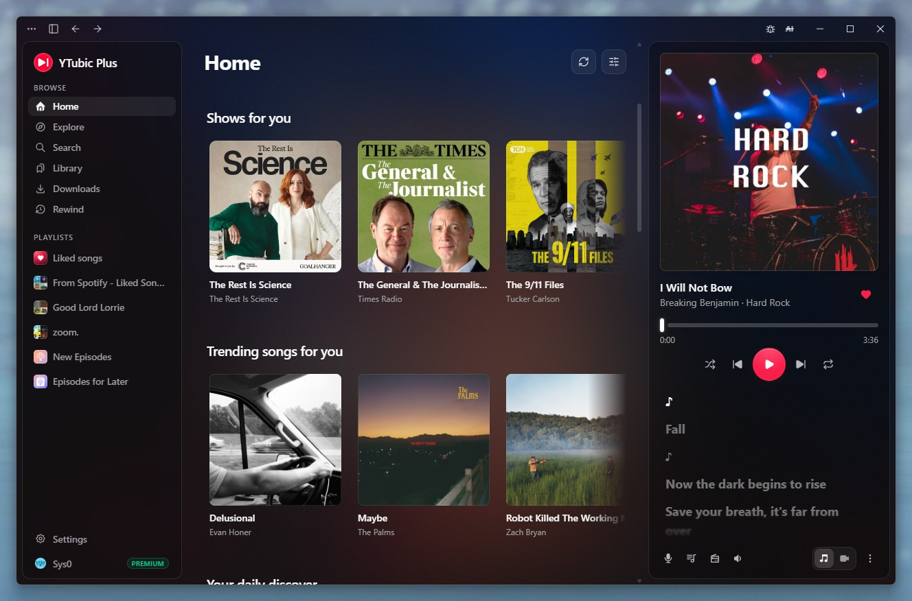

<p align="center">
  
</p>

<h1 align="center">YTubic Plus</h1>

<p align="center">
  A fast, responsive YouTube Music desktop client for Windows, Linux, and macOS,<br />
  now with radio mixes and offline downloads.
</p>

<p align="center">
  <sub>A community edition by <a href="https://github.com/Homefronts"><b>Homefronts</b></a>,
  built on <a href="https://github.com/NUber-dev/YTubic"><b>YTubic</b></a> by George Shyshov (NUber).</sub>
</p>

<p align="center">
  <a href="LICENSE"></a>
</p>

<p align="center">
  <a href="../../releases/latest">
    
  </a>
  <a href="https://discord.gg/4gccUpZyYH">
    
  </a>
</p>

Built as a reaction to the sluggish webview-wrapper experience — YTubic talks to YouTube's InnerTube API directly, renders its own UI, and caches aggressively, so navigation and playback feel instant.



## What's new in Plus

- **Radio button** — start a mix from whatever is playing, right next to the queue button. Click it again to stop and resume your album or playlist where you left off.
- **Mood chips** — while a mix plays, the queue shows YouTube Music's chips (All, Familiar, Discover, Chill, …) to reshape what's coming up.
- **Offline downloads** — a Spotify-style download toggle on every playlist, album and Liked Songs, plus "Download" on single songs. Downloaded playlists stay in sync with new songs automatically.
- **Downloads page** — everything you've saved, in the sidebar, playable with no internet (for up to 30 days between Premium check-ins).
- **AI music filter** — one button in the top bar hides AI-generated music from search, home and mixes, using community lists checked against Spotify. Songs by AI artists carry an **AI** tag either way.
- **Rewind** — a year-in-review style recap of your own listening, every quarter: bold full-screen slides of your minutes, top artists, songs and genres, your listening personality, and a share card, with your favourite songs playing underneath. Built and kept on your computer only; you can also import this quarter's plays from a Google Takeout export.
- **Music videos** — the Song/Video switch actually plays the music video, synced to the song, in the player and in full screen. Video stays on as you skip, like YouTube Music, with quality from 360p to 4K.
- **Own update channel** — Plus updates itself from [this fork's releases](../../releases), so it never gets replaced by an upstream build.

## Roadmap

Ideas for future Plus releases. Not promises.

### Next up

Small, quick to build.

- [ ] **Sleep timer** — stop after X minutes or at the end of the current song.
- [ ] **Full-screen touches** — double-click the cover to like the song, and keep the computer awake while the full-screen player is open.
- [ ] **Remove duplicates from a playlist** — one click to drop repeated songs from your own playlists.
- [ ] **"AI songs hidden" counter** — a small note in search showing how many AI results were filtered, with a way to peek.
- [ ] **Share your AI marks** — turn your Mark as AI choices into a one-click report to the community list.
- [ ] **Skip non-music parts of videos** — optional [SponsorBlock](https://sponsor.ajay.app) skipping of intros and skits in music videos (its "Non-Music Section" category), credited per its CC BY-NC-SA licence.
- [ ] **Libre.fm and ListenBrainz scrobbling** — next to Last.fm, with a switch per service.

### Later

Bigger pieces of work.

- [ ] **Bring your Spotify library** — move playlists, liked songs and followed artists to YouTube Music for free, no Soundiiz needed. Load Spotify's own data export (or an Exportify CSV, M3U file or pasted list), check the matches on a review screen ("312 matched, 9 unsure, 4 not found"), and the playlists are created on your YouTube Music account. Each song is matched to the same recording, never a cover or live version.
- [ ] **Word-by-word lyrics** — karaoke-style highlighting from more lyrics sources, in an order you choose, with translation, romanization (Japanese, Korean, Chinese and more) and duets laid out left and right.
- [ ] **New releases from artists you follow** — the latest albums, EPs and singles from your YouTube Music subscriptions on Home, marked New for their first week.
- [ ] **Multiple languages** — English, Spanish, Brazilian Portuguese, French, German, Italian, Ukrainian, Russian, Turkish, Indonesian, Hindi, Japanese, Korean and Simplified Chinese, with a language picker in Settings that starts on your system language. Every string is English in the code today, so they move into language files first; after that each new language is one file, and native speakers are welcome to fix or add one.
- [ ] **Drag to reorder playlists** — drag songs around in your own playlists, or drop them onto one in the sidebar.
- [ ] **Share cards** — turn a playlist, an artist or a Rewind into one picture with its covers and top songs, sized for social apps.
- [ ] **Weekly and monthly Rewinds** — a recap for every week and month as well as every quarter, with your listening sessions named by what they were.
- [ ] **Smart playlists** — playlists made of rules (liked, played often, not heard in a while, genre, length) that keep themselves up to date.
- [ ] **Now-playing API for overlays** — a local WebSocket that OBS and stream overlays can read, for music credits on stream.
- [ ] **Video quality by GPU** — pick the default music video quality from what your graphics card can decode smoothly.
- [ ] **Download compression** — smaller offline files.

### Someday

Complicated changes, some needing new servers or apps.

- [ ] **Sign in with Spotify** — an optional extra for an instant import and playlists that stay in sync. Spotify limits new apps to a few users, so this uses your own free Spotify developer key, with a short guide.
- [ ] **Cast to devices on your network** — send playback to a Chromecast, Google TV or DLNA/UPnP speaker or TV, keeping the queue, shuffle and media keys. YouTube's audio links are tied to your connection, so the app would stream through a small local server. On a TV, a YTubic Plus screen shows what's playing, Up Next and the lyrics.
- [ ] **Phone remote** — control YTubic Plus from your phone on the same Wi-Fi, by scanning a QR code.
- [ ] **Themes and add-ons, built in** — like [Spicetify](https://spicetify.app) for Spotify, but part of the app: browse and install community themes and add-ons from Settings, or make and share your own. No patching the client.
- [ ] **Listen together** — a Jams-style shared session with friends on YTubic Plus. Needs a small relay server, so maybe someday.
- [ ] **Android TV app** — a remote-friendly YTubic Plus for the big screen. Voice search and the Now Playing tile on the ATV home screen come first, since the existing apps miss them. A separate app, so maybe someday.

> **All the credit for the app itself goes to [George Shyshov (NUber)](https://github.com/NUber-dev)**,
> who designed and built YTubic. Plus only adds features on top. If you enjoy it,
> please [star the original](https://github.com/NUber-dev/YTubic) and
> [support its author](https://donatello.to/NUber).

## Features

- **Fast and responsive UI** — instant navigation with prefetch and aggressive caching; no page reloads, no spinners on every click
- **Flexible player layouts** — dock the player at the bottom or as a right-side panel
- **Floating player widget** — pop the player out into a compact always-on-top window
- **Synced lyrics** — line-by-line synced lyrics from multiple providers (LRCLIB, Musixmatch, Genius)
- **Hi-res cover art** — upgrades album covers to high-resolution studio art when available
- **Full library support** — your playlists, likes, albums and artists; search with filters; radio/autoplay queues
- **Desktop integration** — media keys and system media controls, tray/menu-bar icon, single instance
- **Auto-updates** — the app updates itself from GitHub Releases, and keeps its yt-dlp copy fresh automatically

> **Disclaimer:** YTubic is an unofficial client. It is not affiliated with,
> endorsed by, or sponsored by Google or YouTube. "YouTube" and "YouTube Music"
> are trademarks of Google LLC. The app streams audio through
> [yt-dlp](https://github.com/yt-dlp/yt-dlp) and may stop working at any time if
> YouTube changes its internals. Use at your own risk.

## Install

Download the latest installer from the [Releases](../../releases) page and run it.

- **Windows 10/11:** run the `.exe` NSIS installer. Pick the `x64` build, or
  the `arm64` one on a Windows on ARM device.
- **macOS 10.15+ (beta):** open the universal `.dmg`; the same build supports
  Apple Silicon and Intel. Login cookies are encrypted with a Keychain-backed
  key.
- **Linux (beta):** install the `.deb` or `.rpm`, or run the `.AppImage`.
  Playback requires WebKitGTK 4.1, GTK 3 and the GStreamer base, good and
  libav plugins. Signing in also requires a desktop Secret Service provider
  such as GNOME Keyring or a compatible KWallet setup.
- On first launch the app downloads its own copy of yt-dlp (~12 MB) into its
  data folder and keeps it updated automatically.
- Signing in is optional: browse and playback work anonymously; sign in to get
  your library, likes, and playlists.

> **Tested on Windows. macOS and Linux builds are included, but haven't been
> tested on real machines yet.** They are compiled and unit-tested in CI. If something
> breaks, please [open an issue](../../issues) — or use the in-app reporter
> (⋯ menu → Report an issue), which attaches your app version and OS
> automatically.

### FAQ

**Windows says "Windows protected your PC" (SmartScreen).**
The installer is not code-signed (certificates are expensive for a free
open-source project). Click "More info" → "Run anyway". The source code is
public — you can audit it or build it yourself.

**macOS says YTubic can't be opened or is from an unidentified developer.**
Release builds are ad-hoc signed until Developer ID credentials are configured,
so they are not notarized. Open **System Settings → Privacy & Security** and
choose **Open Anyway**, or right-click YTubic in Applications and choose
**Open**. As a last resort, clear the downloaded quarantine attribute:

```bash
xattr -cr /Applications/YTubic.app
```

**My antivirus flags the app / yt-dlp.**
yt-dlp is a widely-used open-source downloader that some AV vendors
false-positive on. The binary is downloaded directly from yt-dlp's official
GitHub releases.

**Will Google ban my account for using this?**
Browsing/search/library requests look identical to the official web app, and
audio streaming is fully anonymous (never tied to your account). There are no
known cases of accounts being banned for third-party players — but no
guarantees; see the disclaimer above.

**Playback suddenly stopped working.**
YouTube periodically changes its streaming internals. yt-dlp usually ships a
fix within days, and the app picks it up automatically (it self-updates its
yt-dlp copy every ~3 days). Restarting the app forces the check.

## Stack

- **Shell:** Tauri 2 (Rust backend, system webview — WebView2 on Windows,
  WebKitGTK on Linux, WKWebView on macOS)
- **Frontend:** React 19 + TypeScript
- **Build:** Vite 7
- **Styling:** Tailwind CSS v4
- **Components:** shadcn/ui (new-york style, neutral base, YouTube red accent)
- **Routing:** TanStack Router (file-based, type-safe, prefetch on intent)
- **Data:** TanStack Query
- **Client state:** Zustand
- **Icons:** lucide-react

## Dev

```bash
pnpm install
pnpm tauri dev
```

Frontend-only dev (no Tauri window): `pnpm dev`.

## Quality checks

```bash
pnpm test         # vitest unit tests (pure parsers/matchers)
pnpm lint         # eslint
pnpm format       # prettier --write
pnpm build        # tsc + vite production build
```

CI (`.github/workflows/ci.yml`) runs typecheck, lint, tests, build and Rust
tests on Windows, Linux, and macOS for every push / PR.

## Project layout

```
src/
├── routes/              # TanStack Router file-based routes
├── components/
│   ├── ui/              # shadcn primitives
│   ├── layout/          # AppShell, sidebar, topbar, player bar, floating player, lyrics
│   └── shared/          # Track list/rows, cards, shelves, context menus
├── lib/
│   ├── ai/              # AI music filter: matching, data sync, overrides
│   ├── innertube/        # Raw InnerTube client + parsers
│   ├── lyrics/          # LRCLIB / Musixmatch / Genius sources + LRC parser
│   ├── store/           # Zustand stores
│   ├── audio-engine.ts  # Playback engine
│   ├── stream.ts        # Stream URL resolver (localhost proxy)
│   └── utils.ts         # cn() and friends
└── hooks/
src-tauri/               # Rust backend (axum stream proxy, cookies, tray)
scripts/ai-data/         # Daily job that builds the AI artist list (runs in CI)
docs/                    # Design docs and build plans (see docs/README.md)
```

## Credits

- **[YTubic](https://github.com/NUber-dev/YTubic) by George Shyshov (NUber)** — the original app; YTubic Plus is a fork of it
- **[Homefronts](https://github.com/Homefronts)** — YTubic Plus (radio mixes, offline downloads, AI music filter)
- AI music detection uses community lists: [spotify-ai-blocker](https://github.com/CennoxX/spotify-ai-blocker) by CennoxX (MIT), [loved-music-ai-artists](https://github.com/gounetmusic/loved-music-ai-artists) by gounetmusic (CC BY 4.0) and [CevvalYoutubeAIBlocklist](https://github.com/cevvalkoala/CevvalYoutubeAIBlocklist) by CevvalKoala (Unlicense)
- [yt-dlp](https://github.com/yt-dlp/yt-dlp) — audio streaming
- [LRCLIB](https://lrclib.net) — synced lyrics
- Musixmatch and Genius — lyrics sources
- [Tauri](https://tauri.app), [shadcn/ui](https://ui.shadcn.com),
  [TanStack](https://tanstack.com), and the rest of the stack above

## License

[GPL-3.0](LICENSE) — free to use, modify, and redistribute; derivative works
must stay open source under the same license.
